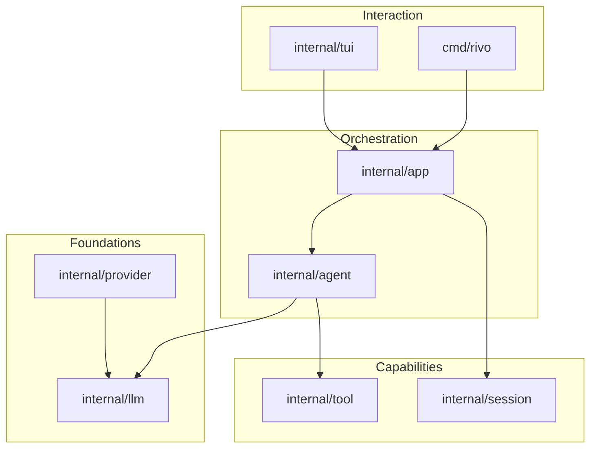

# Rivo

Rivo is an unofficial Go implementation of the PI agent: a coding-agent CLI that reads and writes files, understands requirements, and solves problems

[简体中文](README.md)

## Contents

- [Architecture](#architecture)
- [Install and Build](#install-and-build)
- [Configuration](#configuration)
- [Commands](#commands)

## Architecture



Key capabilities:

- Full-screen TUI with streaming output and visible tool calls and subagent progress; press `alt`+`q` / `option`+`q` to hide/show thinking blocks, tool_use, and tool_result
- Built-in read, ls, grep, find, write, edit, bash, and agentTool tools
- Built-in Plan, Work, and Explore subagents, plus fork subagent
- Uses goja as the JS engine, requires no cgo, and implements codemode
- Sessions persisted as JSONL, with context restore, code rollback, and context compaction
- Multi-vendor support, but currently only OpenAI Completions and OpenAI Responses

## Install and Build

### Windows

```powershell
# Clone the repository
git clone https://github.com/ywxzm03/Rivo.git
cd Rivo

# Build the binary (creates .\rivo.exe)
go build ./cmd/rivo

# Or install to $env:GOPATH\bin
go install ./cmd/rivo
```

#### Uninstall

```powershell
# Remove rivo.exe from the source or release extraction directory
Remove-Item .\rivo.exe -ErrorAction SilentlyContinue

# Remove the binary installed by go install
$bin = go env GOBIN
if (-not $bin) { $bin = Join-Path (go env GOPATH) "bin" }
Remove-Item (Join-Path $bin "rivo.exe") -ErrorAction SilentlyContinue

# To also remove configuration and session data, uncomment the line below
# Remove-Item "$env:USERPROFILE\.rivo" -Recurse -Force
```

### macOS

```sh
curl -fsSL https://raw.githubusercontent.com/ywxzm03/Rivo/main/install.sh | sh
```

#### Uninstall

```sh
# Remove the binary; use the path that matches your installation
sudo rm -f /usr/local/bin/rivo
rm -f ~/.local/bin/rivo

# To also remove configuration and session data, uncomment the line below
# rm -rf ~/.rivo
```

## Configuration

The configuration directory defaults to `~/.rivo`; set `RIVO_AGENT_DIR` to use a different directory. Both `settings.json` and `models.json` are optional; when missing they are treated as empty configuration, but at least one usable credential is still required

### settings.json

```json
{
  "defaultProvider": "deepseek",
  "defaultModel": "deepseek-flash",
  "defaultThinkingLevel": "medium",
  "reserveTokens": 16384,
  "codemode": {
    "enabled": true
  }
}
```

| Field | Description |
| --- | --- |
| `defaultProvider` / `defaultModel` | Default provider and model; set them as a pair; invalid values or missing credentials fall back through the selection chain |
| `defaultThinkingLevel` | Default thinking level; same values as `--effort` |
| `reserveTokens` | Tokens reserved for context compaction; defaults to 16384; model-level `reserveTokens` takes precedence |
| `codemode.enabled` | Whether to enable codemode; defaults to true |

If no default model is configured or available, Rivo tries the built-in `deepseek`, then the first provider with credentials

Built-in `openai` and `deepseek` read credentials from `OPENAI_API_KEY` and `DEEPSEEK_API_KEY` respectively

### models.json

```json
{
  "providers": {
    "deepseek-gateway": {
      "baseUrl": "https://api.deepseek.com",
      "api": "openai-completions",
      "apiKey": "$DEEPSEEK_API_KEY",
      "models": [
        {
          "id": "deepseek-flash",
          "name": "deepseek-flash",
          "contextWindow": 1000000,
          "maxTokens": 384000,
          "reasoning": true,
          "supportsImages": true
        }
      ]
    }
  }
}
```

Provider fields:

| Field | Description |
| --- | --- |
| `baseUrl` | API endpoint; required for new providers, optional when overriding a built-in provider |
| `api` | `openai-responses` or `openai-completions`; defaults to `openai-responses` |
| `apiKey` | API key as plaintext or `$ENV` / `${ENV}`; optional when overriding a built-in provider |
| `models` | Model list; required for new providers |
| `modelOverrides` | Override fields of existing models by model ID |

Model fields:

| Field | Description |
| --- | --- |
| `id` | Model ID; required |
| `name` | Display name; defaults to `id` |
| `api` | Model-level protocol; inherits from the provider by default |
| `contextWindow` | Context window; defaults to 128000 |
| `maxTokens` | Maximum output tokens per request; defaults to 16384 |
| `reserveTokens` | Compaction reserve for this model; falls back to the global value in `settings.json` |
| `reasoning` | Whether the model supports reasoning |
| `supportsImages` / `input` | Whether the model accepts images; `input` containing `image` is equivalent to enabling it |
| `thinkingLevelMap` | Maps thinking levels to reasoning effort; values are `low`, `medium`, `high`, `xhigh`, and `max`; `null` disables a level |
| `samplingParams` | Extra sampling parameters |
| `cost` | USD price per million tokens; fields are `input`, `output`, `cacheRead`, and `cacheWrite` |

## Commands

### CLI

```text
rivo [options] [prompt]
```

| Command | Description |
| --- | --- |
| `rivo` | Open the interactive TUI |
| `rivo <prompt>` | Start with an initial prompt; submits it in the TUI, or runs once and exits without a terminal |
| `rivo -p <prompt>` / `rivo --print <prompt>` | Run one non-interactive turn; the prompt can also come from stdin |
| `rivo --continue` / `--resume` | Continue the most recent session |
| `rivo --session <path\|id>` | Open a session by path, exact ID, or ID prefix |
| `rivo --session-id <id>` | Open a session with the given ID, creating it when missing |
| `rivo --provider <name> --model <pattern>` | Select a provider and model |
| `rivo --model <pattern>` | Model ID, `provider/model`, or a substring, with an optional `:level` suffix |
| `rivo --effort <level>` | Set reasoning effort: `off`, `minimal`, `low`, `medium`, `high`, `xhigh`, `max` |
| `rivo --cost <path>` | Print token and cost totals for a JSONL session |
| `rivo -v` / `--version` | Show version |
| `rivo -h` / `--help` | Show help |

### TUI

Commands start with `/` in the composer; Tab completes them

| Command | Description |
| --- | --- |
| `/tree` | Restore conversation and code state from a historical message |
| `/model [provider/model]` | Switch models; opens a selector without arguments |
| `/effort [level]` | Set reasoning effort; opens a selector without arguments |
| `/resume` | Resume a previous session |
| `/rename <name>` | Rename the current session |
| `/new` | Start a new session |
| `/reload` | Reload AGENTS.md and skills |
| `/clear` | Clear the current conversation context |
| `/delete` | Delete the current session and exit |
| `/compact [instructions]` | Compact the context, optionally with instructions |
| `/status` | Show model, context usage, and session info |
| `/ps` | List background shells |
| `/stop` | Stop all background shells |
| `/exit` | Exit |
| `/skill:<name> [args]` | Invoke a discovered skill |

---

## License
[MIT](LICENSE)
