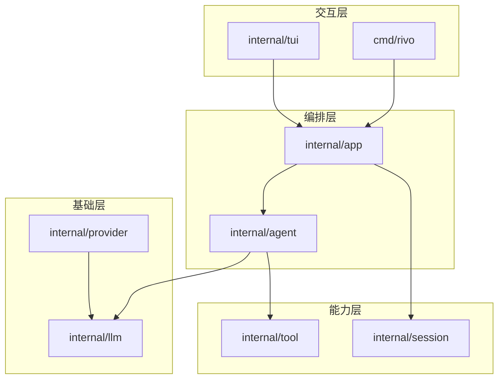

# Rivo

Rivo 是非官方用Go语言实现的PI agent，一个能帮你读写文件，理解需求，解决问题的Coding Agent CLI

[English](README.en.md)

## 目录

- [项目架构](#项目架构)
- [安装与构建](#安装与构建)
- [配置说明](#配置说明)
- [命令说明](#命令说明)

## 项目架构


主要能力：

- 全屏 TUI，流式输出，工具调用与子任务进度可见，可通过`alt`+`q`/`option`+`q`来隐藏/显示thinking block、tool_use、tool_result
- 内置 read、ls、grep、find、write、edit、bash、agentTool工具
- 内置 Plan，Work，Explore subagent，以及fork subagent
- 采用 goja 作为JS引擎，无需cgo，实现codemode
- 会话以 JSONL 持久化，支持上下文恢复、代码回滚、上下文压缩
- 多厂商适配，但当前只支持OpenAI Completions、OpenAI Responses

## 安装与构建

### Windows

```powershell
# 克隆仓库
git clone https://github.com/ywxzm03/Rivo.git
cd Rivo

# 构建二进制（生成 .\rivo.exe）
go build ./cmd/rivo

# 或安装到 $env:GOPATH\bin
go install ./cmd/rivo
```

#### 卸载

```powershell
# 删除源码目录或 release 解压目录里的 rivo.exe
Remove-Item .\rivo.exe -ErrorAction SilentlyContinue

# 删除 go install 安装的二进制
$bin = go env GOBIN
if (-not $bin) { $bin = Join-Path (go env GOPATH) "bin" }
Remove-Item (Join-Path $bin "rivo.exe") -ErrorAction SilentlyContinue

# 如需同时删除配置和会话数据，取消下面这行注释
# Remove-Item "$env:USERPROFILE\.rivo" -Recurse -Force
```

### macOS

```sh
curl -fsSL https://raw.githubusercontent.com/ywxzm03/Rivo/main/install.sh | sh
```

#### 卸载

```sh
# 删除二进制，按实际安装位置二选一
sudo rm -f /usr/local/bin/rivo
rm -f ~/.local/bin/rivo

# 如需同时删除配置和会话数据，取消下面这行注释
# rm -rf ~/.rivo
```

## 配置说明

配置目录默认是 `~/.rivo`，可用 `RIVO_AGENT_DIR` 指定其他目录；`settings.json` 与 `models.json` 都可省略，缺失时按空配置处理，但仍需要至少一个可用凭据

### settings.json

```json
{
  "defaultProvider": "deepseek",
  "defaultModel": "deepseek-flash",
  "defaultThinkingLevel": "medium",
  "reserveTokens": 16384,
  "codemode": {
    "enabled": true
  }
}
```

| 字段 | 说明 |
| --- | --- |
| `defaultProvider` / `defaultModel` | 默认 provider 与模型，需成对设置；无效或缺凭据时按回退链选择 |
| `defaultThinkingLevel` | 默认思考等级，取值同 `--effort` |
| `reserveTokens` | 上下文压缩预留 token，默认 16384；模型级 `reserveTokens` 优先 |
| `codemode.enabled` | 是否启用 codemode，默认 true |

默认模型未配置或不可用时，依次尝试内置 `deepseek`、首个有凭据的 provider

内置 `openai`、`deepseek` 分别从 `OPENAI_API_KEY`、`DEEPSEEK_API_KEY` 读取凭据

### models.json

```json
{
  "providers": {
    "deepseek-gateway": {
      "baseUrl": "https://api.deepseek.com",
      "api": "openai-completions",
      "apiKey": "$DEEPSEEK_API_KEY",
      "models": [
        {
          "id": "deepseek-flash",
          "name": "deepseek-flash",
          "contextWindow": 1000000,
          "maxTokens": 384000,
          "reasoning": true,
          "supportsImages": true
        }
      ]
    }
  }
}
```

provider 字段：

| 字段 | 说明 |
| --- | --- |
| `baseUrl` | API 端点；新增 provider 必填，覆盖内置 provider 时可省略 |
| `api` | `openai-responses` 或 `openai-completions`，默认 `openai-responses` |
| `apiKey` | API key，可写明文或 `$ENV`、`${ENV}`；覆盖内置 provider 时可省略 |
| `models` | 模型列表；新增 provider 必填 |
| `modelOverrides` | 按模型 ID 覆盖已有模型的字段 |

模型字段：

| 字段 | 说明 |
| --- | --- |
| `id` | 模型 ID，必填 |
| `name` | 展示名，默认同 `id` |
| `api` | 模型级协议，默认继承 provider |
| `contextWindow` | 上下文窗口，默认 128000 |
| `maxTokens` | 单次输出上限，默认 16384 |
| `reserveTokens` | 该模型的压缩预留量，未设置时用 `settings.json` 的全局值 |
| `reasoning` | 是否支持推理 |
| `supportsImages` / `input` | 是否接受图片，`input` 包含 `image` 等价于开启 |
| `thinkingLevelMap` | 思考等级到 reasoning effort 的映射，取值为 `low`、`medium`、`high`、`xhigh`、`max`，`null` 表示禁用该等级 |
| `samplingParams` | 额外采样参数 |
| `cost` | 每百万 token 的美元单价，字段为 `input`、`output`、`cacheRead`、`cacheWrite` |

## 命令说明

### CLI

```text
rivo [options] [prompt]
```

| 命令 | 说明 |
| --- | --- |
| `rivo` | 打开交互式 TUI |
| `rivo <prompt>` | 带初始提示启动；终端下自动提交，无终端时执行一轮后退出 |
| `rivo -p <prompt>` / `rivo --print <prompt>` | 非交互执行一轮，提示也可从 stdin 读取 |
| `rivo --continue` / `--resume` | 继续最近会话 |
| `rivo --session <path\|id>` | 按路径、完整 ID 或 ID 前缀打开会话 |
| `rivo --session-id <id>` | 打开指定 ID 的会话，不存在时新建 |
| `rivo --provider <name> --model <pattern>` | 指定 provider 与模型 |
| `rivo --model <pattern>` | 模型 ID、`provider/model` 或子串，可加 `:level` 后缀 |
| `rivo --effort <level>` | 设置推理强度：`off`、`minimal`、`low`、`medium`、`high`、`xhigh`、`max` |
| `rivo --cost <path>` | 统计指定 JSONL 会话的 token 与费用 |
| `rivo -v` / `--version` | 显示版本 |
| `rivo -h` / `--help` | 显示帮助 |

### TUI

在输入框中以 `/` 开头执行，Tab 可补全

| 命令 | 说明 |
| --- | --- |
| `/tree` | 从历史消息恢复对话与代码状态 |
| `/model [provider/model]` | 切换模型；不带参数打开选择器 |
| `/effort [level]` | 设置推理强度；不带参数打开选择器 |
| `/resume` | 恢复历史会话 |
| `/rename <name>` | 重命名当前会话 |
| `/new` | 新建会话 |
| `/reload` | 重新加载 AGENTS.md 与 skills |
| `/clear` | 清空当前对话上下文 |
| `/delete` | 删除当前会话并退出 |
| `/compact [instructions]` | 压缩上下文，可附带指令 |
| `/status` | 查看模型、上下文用量和会话信息 |
| `/ps` | 列出后台 shell |
| `/stop` | 停止所有后台 shell |
| `/exit` | 退出 |
| `/skill:<name> [args]` | 调用已发现的 skill |

---

## License
[MIT](LICENSE)